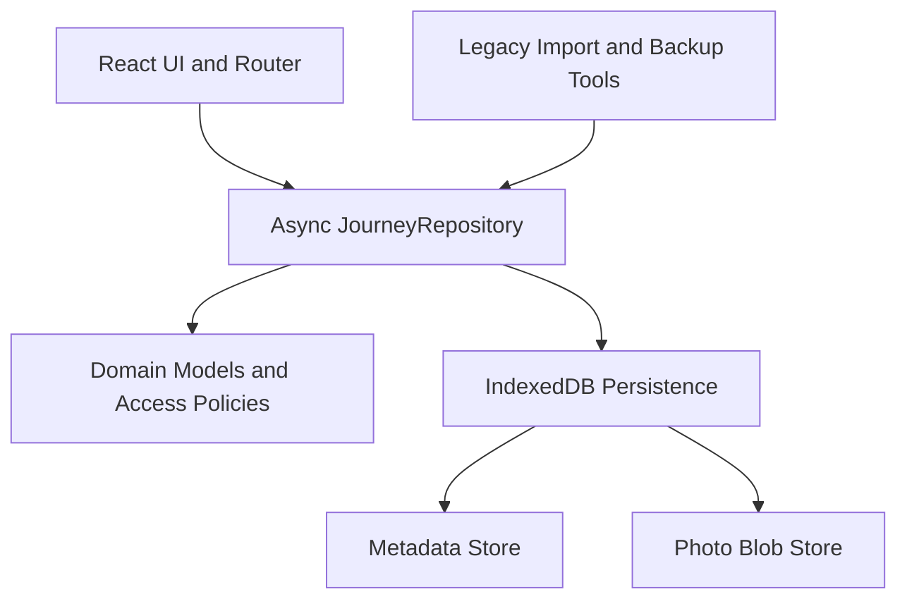

# Our Journey

**A local-first digital memory journal for collecting, organizing, and revisiting meaningful moments.**


## Overview

Our Journey is a responsive photo gallery and personal memory management application. It brings albums, photographs, stories, and social interactions into a single browser-based experience.

Originally developed with vanilla HTML, CSS, and JavaScript, the project is evolving into a modular React and TypeScript application with local-first persistence, reusable UI components, and automated quality checks.

> **Development status:** The modern frontend runs independently with synthetic demo data. Production deployment and complete legacy-data migration remain blocked pending privacy and migration checks.

## Features

| Area | Capabilities |
| --- | --- |
| Albums | Create, edit, organize, and manage album covers |
| Memories | Multi-image upload, stories, metadata, search, sorting, and reordering |
| Photo viewer | Image previews, full-resolution viewing, and responsive layouts |
| Collaboration demo | Local invitations, membership roles, comments, and reactions |
| Data portability | Legacy import dry-run, explicit owner mapping, versioned backups, and restore |
| User experience | Responsive navigation, accessible dialogs, keyboard interactions, and reduced-motion support |
| Image performance | Generated thumbnails with a maximum long edge of 640 px; originals retained for viewing |

Collaboration and identity features operate within the local datastore. They do not provide server-side authentication, remote invitations, or cross-device synchronization.

## Architecture



- **Presentation:** React components, route-based navigation, shared UI primitives, and Radix Dialog.
- **Domain:** Album, memory, membership, and interaction rules separated from presentation.
- **Persistence:** Asynchronous repository abstraction over IndexedDB, with separate metadata and photo storage.
- **Data integrity:** Import validation, deduplication, checkpoints, checksums, and non-destructive restore.
- **Access policies:** Local owner, contributor, viewer, and outsider permission checks; not a server security boundary.

## Technology Stack

| Layer | Technologies |
| --- | --- |
| Frontend | React 19, TypeScript 5.9, React Router 7 |
| Build tooling | Vite 8, npm |
| UI | CSS, Radix UI Dialog |
| Persistence | IndexedDB, Blob storage |
| Unit and integration testing | Vitest, Testing Library, fake-indexeddb |
| End-to-end testing | Playwright (Chromium, Firefox, WebKit) |
| Accessibility | axe-core, keyboard and reduced-motion checks |
| Code quality | ESLint, Prettier, TypeScript strict mode |
| CI | GitHub Actions |

## Getting Started

**Requirements:** Node.js 22.12 or newer and npm.

```bash
git clone https://github.com/zaabinh/our-journey.git
cd our-journey/frontend
npm ci
npm run dev
```

Open the local URL printed by Vite. The development server binds to localhost and uses synthetic demo data. No backend or external account is required.

### Quality checks

Run from the `frontend/` directory:

```bash
npm run format:check
npm run lint
npm run typecheck
npm test -- --run
npx playwright install chromium webkit firefox
npm run test:e2e
npm run build
npm run check:private
```

WebKit tests use a persistent synthetic profile because ephemeral/private WebKit contexts have limitations storing Blobs in IndexedDB.

## Engineering and Validation

The [frontend progress report](docs/FRONTEND_PROGRESS.md) records the following historical validation milestones:

| Check | Recorded result |
| --- | --- |
| Unit and integration tests | 33 passing in the documented later regression run |
| Cross-browser E2E | 81 passing in the earlier full three-engine run |
| Accessibility | 60 axe scans without violations in that full run |
| Static checks and build | Passing in documented regression runs |

These are historical results, not a claim that the current commit has been independently retested. Later UI changes had incomplete cross-browser regression coverage, including a WebKit timeout and a Firefox runner initialization failure.

## Repository Layout

```text
our-journey/
├── frontend/             # Modern React + TypeScript application
│   ├── src/              # UI, domain and persistence implementation
│   ├── e2e/              # Browser regression tests
│   ├── package.json
│   └── README.md
├── docs/
│   └── FRONTEND_PROGRESS.md
├── scripts/              # Verification and privacy checks
├── .github/workflows/    # Frontend CI
└── Legacy HTML/CSS/JS    # Original implementation retained at root
```

## Privacy, Security and Migration

This is a local-first development prototype, not a production multi-user service.

- The modern frontend uses synthetic fixtures and does not import legacy credentials or sessions.
- Legacy browser authentication is a mock implementation and must not be used as production authentication.
- The original browser-origin IndexedDB export is still required for complete migration.
- Legacy private media remain tracked in Git. The release privacy gate intentionally fails until remediation is complete. Removing tracked files alone would not remove historical copies.
- Do not publish legacy assets, browser exports, private backups, or QA artifacts.

The build privacy scanner is an additional safeguard, not a substitute for manual review. Deployment remains blocked.

## Roadmap

- [x] Modern React and TypeScript frontend foundation
- [x] Local-first album and memory management
- [x] Local collaboration and permission policies
- [x] Backup, restore, and legacy import tooling
- [x] Responsive UI, thumbnails, and accessibility checks
- [ ] Complete legacy browser-data export and migration
- [ ] Resolve tracked private-data exposure and pass the release gate
- [ ] Complete outstanding browser regression checks
- [ ] Evaluate backend authentication, secure remote storage, and cross-device synchronization

## Documentation

- [Frontend setup and development](frontend/README.md)
- [Implementation progress, validation, and migration blockers](docs/FRONTEND_PROGRESS.md)

---

Developed as a full-stack development course project and evolving personal software engineering project.
